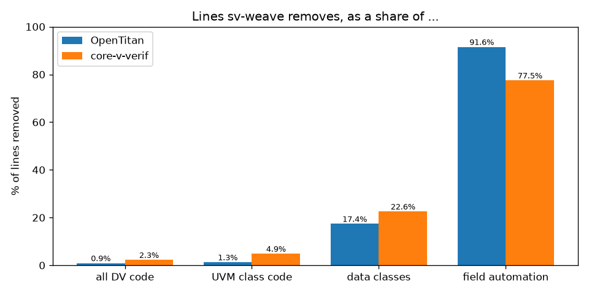
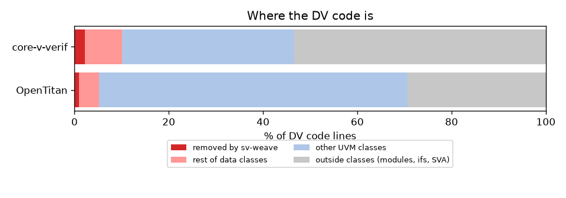
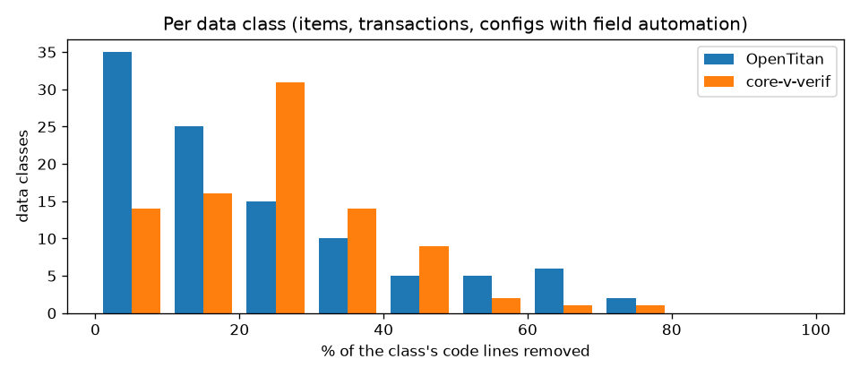
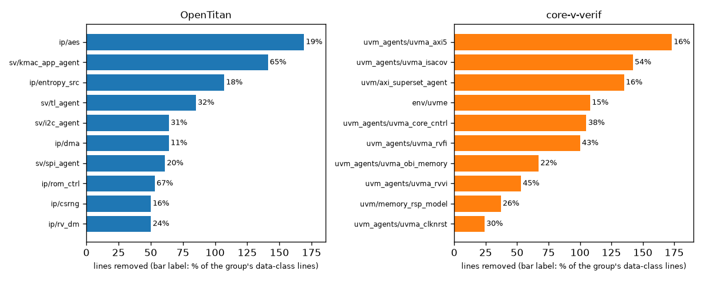
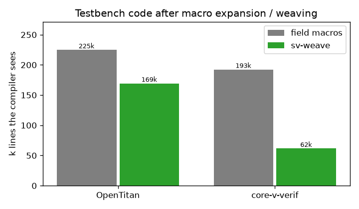
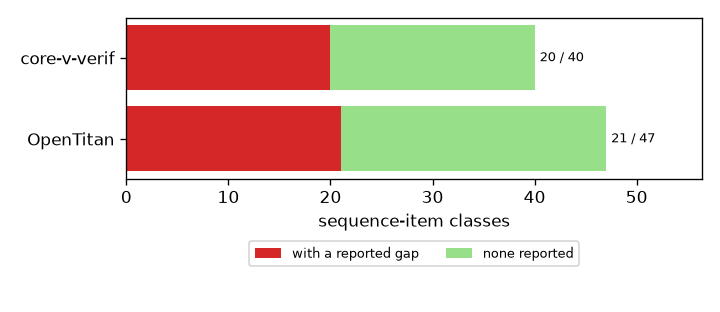

# What sv-weave would save on OpenTitan and core-v-verif

Numbers from `python assess/report.py` (full table: [table.md](table.md), raw:
[numbers.json](numbers.json)). Every count is **code lines**: blank lines and comment
lines are excluded, in both the numerator and the denominator.

## Headline

| | OpenTitan | core-v-verif |
|---|---|---|
| DV code lines | 151,045 | 49,819 |
| lines sv-weave removes (upper bound) | **1,376** | **1,130** |
| ... as % of all DV code | **0.9%** | **2.3%** |
| ... as % of UVM class code | 1.3% | 4.9% |
| ... as % of data-class code (items, transactions, configs) | 17.4% | 22.6% |
| ... as % of field-automation code (field macros + hand do_*) | 91.6% | 77.5% |
| item classes with a copy/compare/print gap | 21 of 47 | 20 of 40 |
| compiled tb text, macros expanded (est.) | 225k | 193k |
| compiled tb text, sv-weave (est.) | 169k (-25%) | 62k (-68%) |

Read honestly: **as a share of the whole testbench the line saving is small,
about 1-2.5%**. Most DV code is components, sequences, scoreboards, interfaces and
assertions, which sv-weave does not touch. The saving is concentrated: it removes
**80-90% of the copy/compare/print/pack code** and about **a fifth of each
transaction class**. The larger wins are not lines:

1. **A class of bug goes away.** Almost half of the sequence-item classes in both trees
   have a member that some operation silently skips (not copied, copied but not
   compared, compared but not printed). sv-weave covers every member by default.
2. **The compiler sees less code.** `uvm_field_*` macros expand to ~100-400 lines each;
   woven code is ~15 lines per member. On core-v-verif, which uses field macros heavily,
   the compiled testbench text (UVM library excluded) drops by about two thirds.

## Where the DV code is

The red sliver is what sv-weave removes; pink is the rest of the data classes.

## Per data class

Median per class: 16% (OpenTitan), 25% (core-v-verif) of the class's code lines.
Classes that hand-write do_copy/do_compare/do_print lose the most (up to ~80%).

## Compiled size and gaps

Gap findings in item classes (rules in `assess/gaps.py`): OpenTitan G1 (not copied) 89,
G2 (copy/compare mismatch) 96, G3 (not printed) 59, G5 (no automation) 3; core-v-verif
G1 25, G2 1, G4 (do_* without super call) 8, G5 2. Some gaps are deliberate (a member
left out of compare on purpose without a UVM_NOCOMPARE flag), so this counts candidates,
not confirmed bugs. Of 14 OpenTitan item classes checked by hand, 10 had real gaps,
2 had gaps of little impact and 2 were intended (docs/user/assessment.rst).

## Method and caveats

- Trees: OpenTitan `hw/**/dv/**` (1,722 files); core-v-verif all .sv/.svh (565 files).
  Classes found with pyslang (`assess/scan.py`), sized with `assess/size.py`.
- "Data class" = a `uvm_object`/`uvm_sequence_item`-derived class with field macros or
  a hand-written do_copy/do_compare/do_print/convert2string/do_pack. Extern method
  bodies outside the class are counted as part of the class.
- **Removed lines are an upper bound**: field-macro lines + hand do_* lines, minus the
  sv-weave attribute lines added back. A hand method that does more than copy/compare
  fields (custom formatting, special compare rules) would partly stay.
- Compiled sizes are estimates: per-macro expansion sizes measured on UVM 1.2 macros,
  and ~15 woven lines per member; the UVM library itself is excluded.
- Run time was measured separately in batch 1 (docs/user/benchmark.rst).
