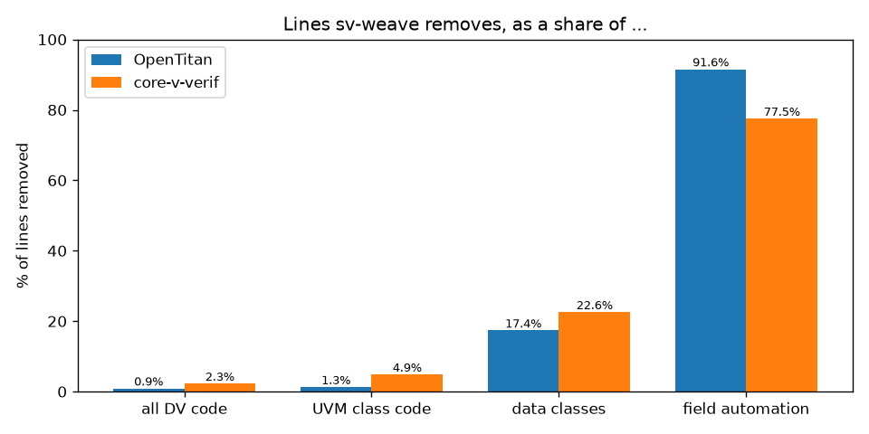
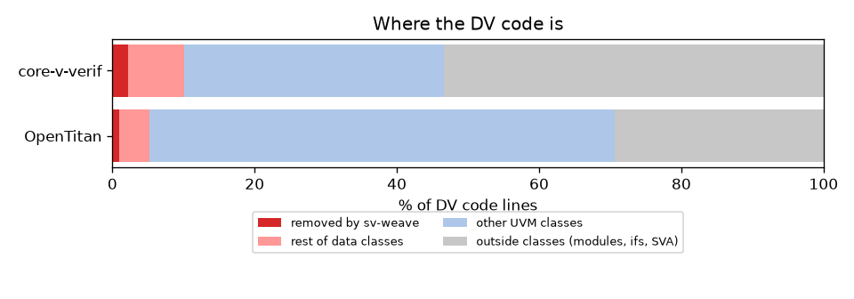
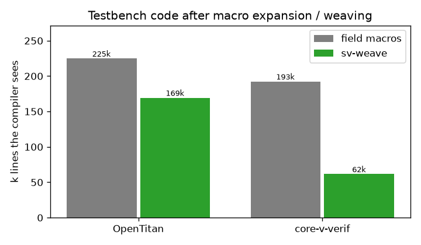

Assessment: OpenTitan and core-v-verif
======================================

What would sv-weave-uvm have caught, and how much code would it save, in two large open
UVM testbenches? We scanned OpenTitan (master ``7d46c64``) and OpenHW core-v-verif
(master ``b137fd2``) for transaction classes whose ``copy``/``compare``/``print`` miss
fields, and estimated the code that weaving would replace. The tools are in ``assess/`` of
the repository; ``assess/results/README.md`` has the commands, all findings and the
per-group tables.

Method
------

- ``assess/scan.py`` parses every class with pyslang and records its members, its
  ``uvm_field_*`` registrations and its hand-written ``do_*`` methods. Classes derived
  from ``uvm_sequence_item`` are *items*; other ``uvm_object`` classes are *objects*.
- ``assess/gaps.py`` applies six rules, on the union of field macros and hand ``do_*``
  methods. G1: a member no copy path covers, in a class with some automation. G2: a
  member copied but not compared, or the reverse. G3: a member copied but not printed. G4:
  a hand ``do_*`` without a ``super`` call. G5: data members and no automation at all.
  G6: ``do_pack`` without ``do_unpack`` (or the reverse), or a member touched by
  only one of them.
- ``assess/size.py`` counts field-macro lines and hand ``do_*`` lines per class, and
  estimates the attribute lines sv-weave would need instead.

Scanned: OpenTitan ``hw/dv/sv``, ``hw/ip``, ``hw/top_earlgrey`` (2708 files, 1339 classes,
47 items, 113 objects); core-v-verif ``lib/uvm_agents``, ``uvm_libs``, ``uvm_components``,
``cv_dv_utils/uvm`` and ``cv32e40{p,s,x}/env`` (565 files, 462 classes, 40 items, 63
objects).

Findings
--------

=====  ======  ====  ====  ====  ====  ====
tree   kind    G1    G2    G3    G4    G5
=====  ======  ====  ====  ====  ====  ====
OT     item    89    96    59    0     3
OT     object  613   1     0     3     50
cv     item    25    1     0     8     2
cv     object  62    0     0     0     4
=====  ======  ====  ====  ====  ====  ====

Most *object* findings are on ``*_cfg`` and ``*_cntxt`` classes, which are shared by handle
and rarely copied; every one we checked by hand was intended. Transaction classes are the
opposite: of 14 OpenTitan item classes checked by hand, 10 had real gaps, 2 had gaps of
little impact (unregistered randomization knobs) and 2 were intended. Examples:

- ``spi_transaction_item`` (OpenTitan spi_host): ``do_copy`` copies no members and calls
  ```downcast`` with its arguments reversed, so ``copy()`` drops ``cmd`` and ``segments``.
- ``rv_dm_mode_seq_item``: only ``do_print``; ``copy()`` loses all 20 members.
- ``aes_message_item``: a 37-member hand ``do_copy`` and no ``do_compare``;
  ``fixed_key``/``fixed_iv`` are not copied although ``fixed_key_en`` is.
- ``aes_seq_item``, ``usb20_item``, ``csrng_item``, ``racl_error_log_item``,
  ``spi_segment_item``: ``do_compare`` missing or covering a subset.
- ``memory_txn`` (core-v-verif memory response model): registers 2 of its 12 fields, so
  ``copy()`` and ``compare()`` ignore id, address, data, strobes, error and command.
- ``uvma_obi_memory_mon_trn_c``: ``exokay`` not registered; ``uvma_cvxif_req/resp_item_c``:
  random members with no automation at all.

sv-weave closes all of these by construction: every field is copied, compared and printed
unless an attribute says otherwise, so a field added later cannot be forgotten.

Proof: memory_txn
-----------------

``assess/ports/memory_txn`` puts the core-v-verif class, unchanged, next to its port: the
same class with the field macros dropped (one ```uvm_object_param_utils`` line instead of
four), woven with ``copy``, ``compare`` and ``do_print``. ``tests/sim/test_assess_ports.py``
runs both on Verilator. The original's ``copy()`` leaves ``addr``, ``data`` and ``cmd`` at
their defaults and its ``compare()`` calls such objects equal; the port copies all 12
fields, catches a ``data`` or ``atop`` mismatch, prints every field (enums by name) and
keeps the hand-written ``convert2string()``.

Code size
---------

Data classes only (items and transaction-like objects with field automation or hand
``do_*`` methods):

=================================  =======  ======  =======  ========  =========  ===========
root                               classes  field   hand     sv-weave  saved src  expanded
                                            macros  do_*     lines                macro lines
=================================  =======  ======  =======  ========  =========  ===========
OT hw/dv/sv                        54       371     395      85        681        50643
OT hw/ip                           43       171     635      36        770        21706
OT top_earlgrey                    6        18      0        6         12         2078
cv lib/uvm_agents                  61       723     352      231       844        103719
cv lib/uvm_libs                    5        43      0        25        18         5295
cv lib/cv_dv_utils/uvm             13       119     162      60        221        17161
cv cv32e40{p,s,x}/env              9        101     22       12        111        17499
=================================  =======  ======  =======  ========  =========  ===========

In source, OpenTitan would lose about 1460 lines and core-v-verif about 1190. The larger
effect is in what the compiler sees: the field macros expand to about 74k lines in
OpenTitan and 144k in core-v-verif, against an estimated 20k and 13k woven lines. ``saved
src`` is an upper bound: hand ``do_*`` methods that do more than per-field work would partly
stay. ``sv-weave lines`` counts one attribute per field whose macro carries ``UVM_NO*`` or
radix flags.

Savings as a share of the testbench
-----------------------------------

``python assess/report.py`` puts the saving next to the code around it, counting code
lines only (no blank or comment lines) on both sides; hand ``do_*`` bodies counted that
way, the saving is 1376 lines (OpenTitan) and 1130 (core-v-verif). Full report with all
charts: ``assess/results/report/report.md``.

======================================================  =========  ============
lines sv-weave removes, as a share of                   OpenTitan  core-v-verif
======================================================  =========  ============
all DV code (151,045 / 49,819 lines)                    0.9%       2.3%
code inside UVM classes                                 1.3%       4.9%
data-class code (items, transactions, configs)          17.4%      22.6%
field-automation code (field macros + hand ``do_*``)    91.6%      77.5%
======================================================  =========  ============

As a share of the whole testbench the saving is small: most DV code is components,
sequences, scoreboards, interfaces and assertions, which sv-weave does not touch. It is
concentrated where it applies: 80-90% of the copy/compare/print code and about a fifth of
each transaction class. The larger effects are the gaps closed (21 of 47 and 20 of 40 item
classes have one) and the compiled size.







Limits
------

- Gap rules are syntactic: a member left out on purpose is still reported. Item findings are
  mostly real; object findings mostly are not (see above).
- Only the trees listed were scanned; OpenTitan's ``top_darjeeling`` and
  ``top_englishbreakfast`` are generated copies and would double-count.
- No bugs were reported upstream.
